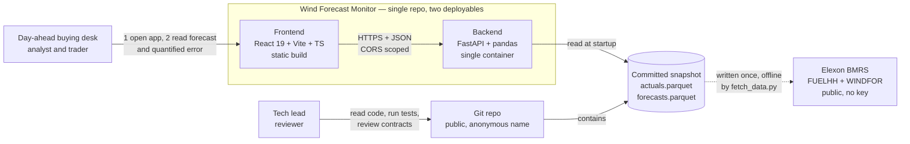
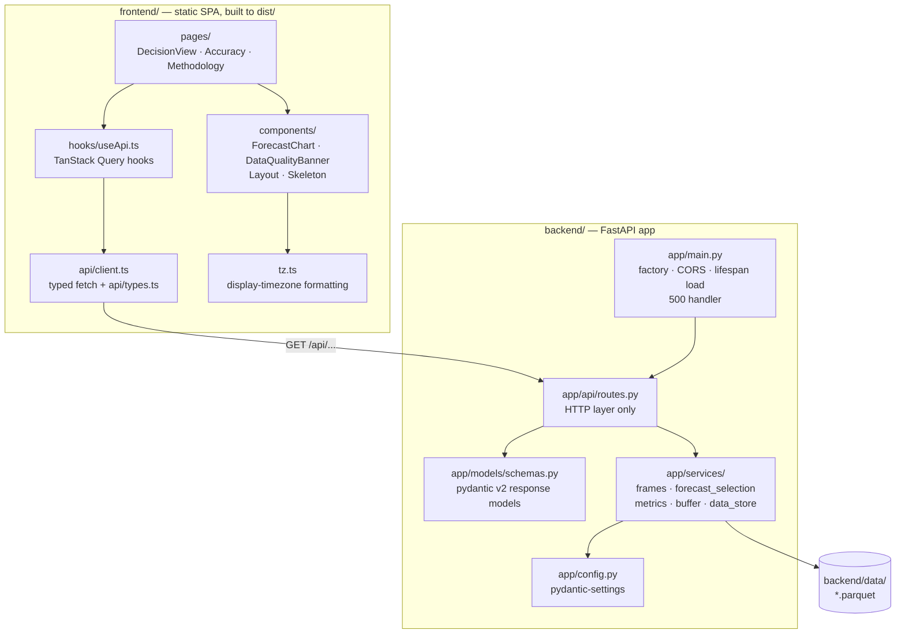
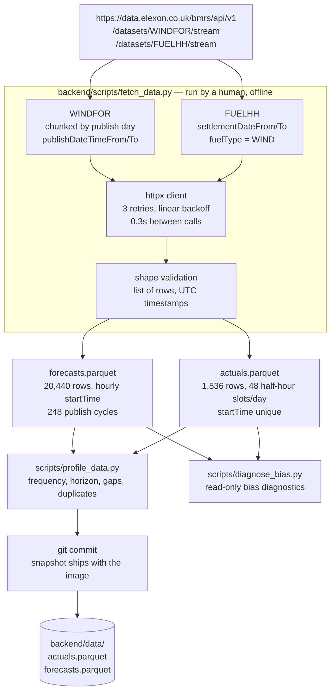
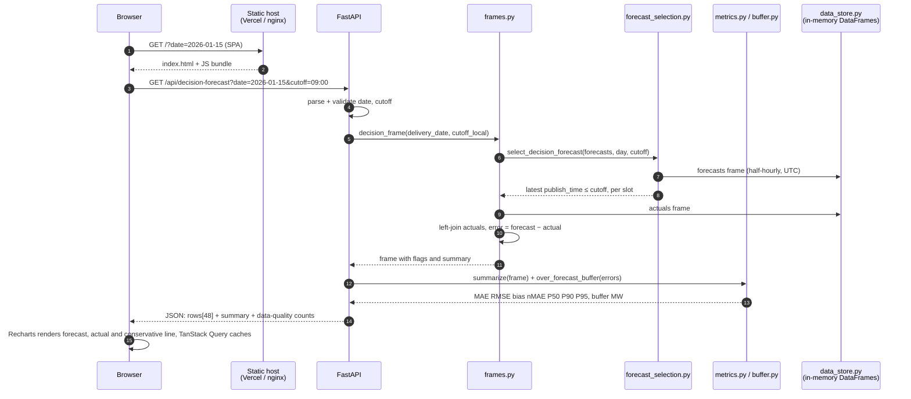
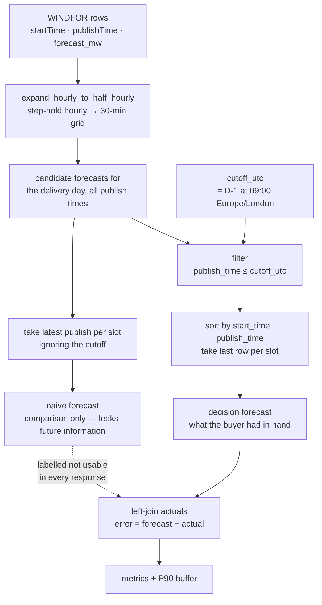
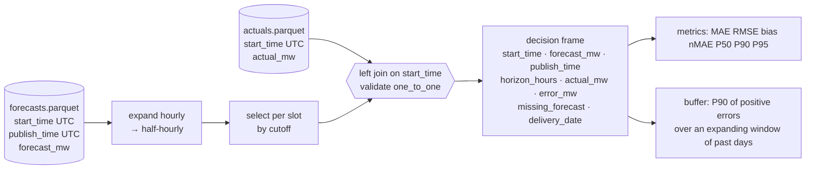
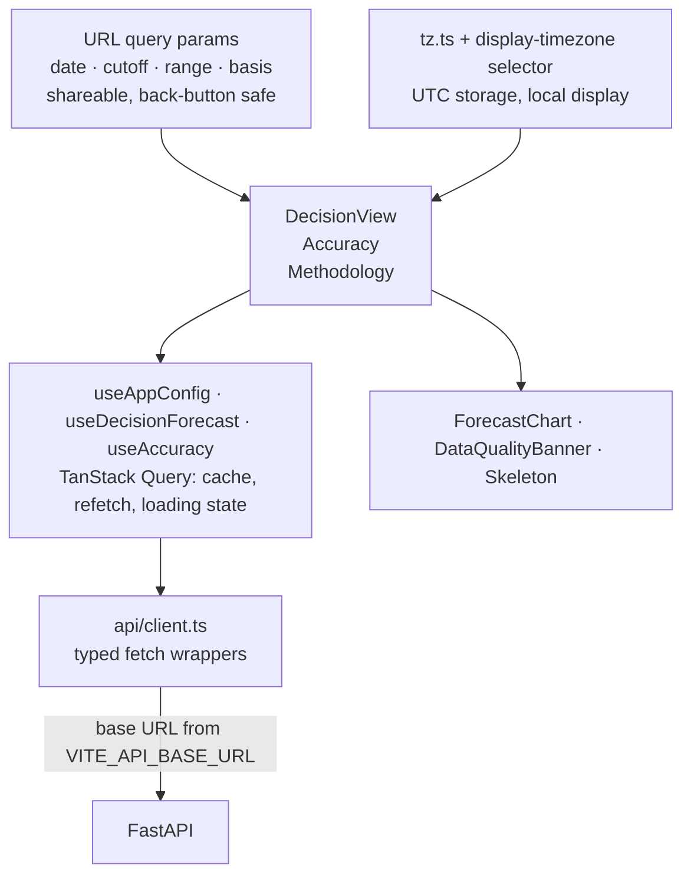
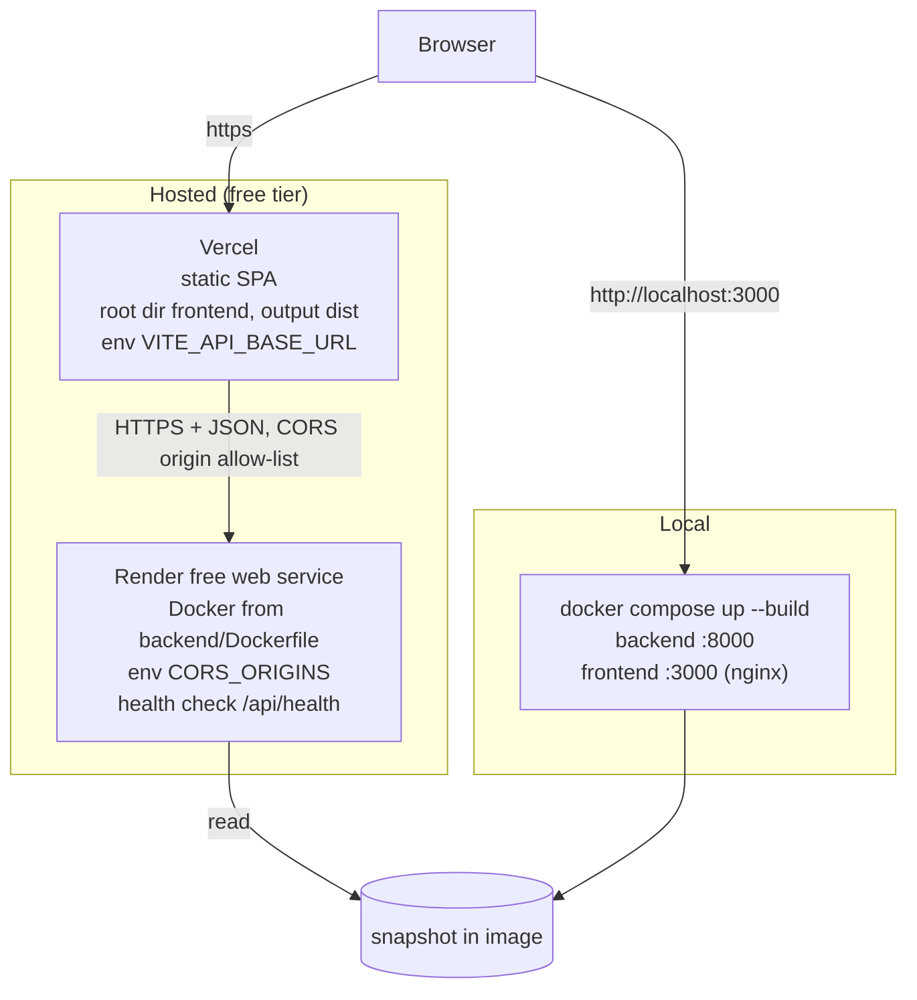

# Architecture

Wind Forecast Monitor — a decision-support portal for a UK utility's day-ahead power buying desk.

Scope: national wind generation only (Elexon BMRS `FUELHH` fuelType `WIND` actuals, `WINDFOR` forecasts),
delivery days 2 Jan 2026 → 1 Feb 2026, decisions taken on D-1 between 09:00 Europe/London.

---

## 1. System context

Who uses it, what it depends on, what it depends on.

Design position: **no database, no runtime call to Elexon.** The evaluation month is January 2026 and
that data is immutable, so the fetch happens once, offline, and the result is committed. Deploys are
reproducible and do not depend on a third-party uptime window.

---

## 2. Container and module view

Layering rule, in one line: **pure domain logic in `app/services`, thin I/O in `app/api`, no business
rules in the frontend.** A reviewer can read `app/services/` alone and know the product.

---

## 3. Offline data pipeline (how the snapshot is produced)

Verified API facts (source of truth: `docs/DOMAIN_AND_ASSUMPTIONS.md`):

| Fact | Value used by the code |
|---|---|
| FUELHH actuals | 1,536 rows, `startTime` unique, `publishTime = startTime + 30 min` |
| WINDFOR granularity | **hourly** `startTime` — must be step-held to half-hourly |
| WINDFOR publish cycles | 73 rows per cycle, ~72h rolling horizon, irregular 120/180/240-min gaps |
| Fetch chunking | day-size windows; sub-hour windows return `[]` |
| Timestamps | all UTC (`Z`); converted to Europe/London only for cutoff and display |

**Consequence that shapes the backend:** `expand_hourly_to_half_hourly` in
`app/services/forecast_selection.py` step-holds each hourly forecast across the two half-hour slots
it covers, so forecasts and actuals share one 30-minute grid. Lead time (`horizon_hours`) is derived
from the *selected* publish time, so it describes the number the buyer actually saw.

---

## 4. Runtime: how a decision-view request is served

Response shape is fixed by `docs/API_SPEC.md`; backend models are pydantic v2
(`app/models/schemas.py`) and the frontend mirrors them as TypeScript types (`frontend/src/api/types.ts`).
A contract change therefore breaks a type check, not a page.

**Missing data is never filled or silently dropped.** Every response carries
`n_slots`, `n_missing_forecast`, `n_missing_actual`, and every row carries `flags`
(`missing_forecast`, `missing_actual`). The frontend renders flagged slots as amber rows and surfaces
the counts in `DataQualityBanner`.

---

## 5. The core rule: decision-time forecast selection

This is the part the whole product rests on, and the part that must have no look-ahead.

Invariants, and where they are proven:

| Invariant | Enforcement | Test |
|---|---|---|
| A forecast published after the cutoff is ineligible | `publish_time <= cutoff` filter in `forecast_selection.py` | `tests/test_forecast_selection.py` |
| Publish exactly at the cutoff is included; +1 s is not | inclusive `<=` comparison | same file, boundary case |
| Selection is deterministic | sort on `start_time`, `publish_time`, take last per slot | same file |
| Naive differs from decision-time | separate code path, asserted unequal | same file |
| Slots with no eligible forecast are flagged, not invented | `missing_forecast` flag, counted in the response | `tests/test_api.py` |

Timezone handling: all storage and comparison is UTC. `Europe/London` appears in exactly two places —
computing the cutoff (`cutoff_utc_for`) and formatting for display. GMT and BST therefore follow the
same code path; January is GMT, but the logic is not January-specific.

---

## 6. Data model in memory

| Frame | Built by | Used for |
|---|---|---|
| `decision_frame` | `frames.py` | decision view; error per slot |
| `naive_frame` | `frames.py` | leakage comparison (labelled) |
| `all_horizon_frame` | `frames.py` | accuracy dashboard, all forecast lead times |

Metric definitions (`app/services/metrics.py`, `app/services/buffer.py`):

- `error = forecast − actual`; **positive = over-forecast = the buyer is short.**
- `MAE`, `RMSE`, `bias`, `nMAE = MAE / mean actual`, `P50/P90/P95` of absolute error.
- nMAE rather than MAPE: generation approaches zero in some half-hours, where MAPE is meaningless.
- Buffer = P90 of **positive** errors only, over an expanding window of past delivery days, so a
  decision never uses a day that had not happened yet. Early days fall back to the full period and the
  response reports the basis (`expanding_window`) and sample size.

---

## 7. Frontend shape

- Server state lives in TanStack Query; shareable state (date, cutoff, basis) lives in the URL.
- Units are consistent MW throughout; loading, empty and error states are explicit, not blank.
- One page per question: *what did I have?* / *how wrong is it?* / *how was it computed?*

---

## 8. Deployment topology

| Piece | Where | Notes |
|---|---|---|
| Backend image | `backend/Dockerfile` | `uvicorn` on `$PORT`; snapshot copied in; one env var `CORS_ORIGINS` (JSON list) |
| Frontend | `frontend/Dockerfile` + `nginx.conf` | nginx serves `dist/` and proxies `/api` to the backend |
| Static host | `frontend/vercel.json` | SPA rewrite, so deep links like `/accuracy` work |
| API host | `render.yaml` | blueprint: docker runtime, free plan, `/api/health` health check |
| Local | `docker-compose.yml` | same images as prod — Docker parity with deploy |

Run steps and the CORS / `VITE_API_BASE_URL` checklist: `docs/DEPLOYMENT.md`.

---

## 9. Engineering practices

| Practice | Where it shows |
|---|---|
| Pure functions for the two things that matter (selection, metrics) | `app/services/forecast_selection.py`, `app/services/metrics.py` |
| Unit tests on boundaries, not on plumbing | `tests/test_forecast_selection.py` (cutoff boundary, +1 s exclusion, naive ≠ decision), `tests/test_metrics.py` (hand-computed fixture), `tests/test_buffer.py`, `tests/test_api.py` (TestClient) |
| Config over constants | `app/config.py` — cutoff time, timezone, decision window, data dir, CORS |
| Explicit data-quality reporting | counts and per-slot flags in every response; no silent fill or drop |
| Reproducible data | committed snapshot; documented Elexon API facts; read-only diagnostic scripts |
| Typed contract on both sides | pydantic v2 models ↔ TypeScript types, spec in `docs/API_SPEC.md` |
| Automated checks | `pytest -q` (25 tests), `ruff check` / `ruff format`, `oxlint`, `tsc -b` inside the frontend build |
| Small commits, docs updated with behaviour | `docs/TASKS.md` milestone checklist |

---

## 10. Known gaps and documentation drift (honest list for review)

| Item | Status | Note |
|---|---|---|
| `POST /api/refresh` | **specified in `docs/API_SPEC.md`, not implemented** | either implement (re-pull from Elexon on demand) or drop it from the spec; currently the only contract/implementation mismatch |
| `app/services/elexon_client.py` | **no longer exists** | fetching lives in `backend/scripts/fetch_data.py` (offline, with retry/backoff and validation). This document previously listed it as a service |
| Frontend component list | corrected here | actual components are `ForecastChart`, `DataQualityBanner`, `Layout`, `Skeleton`; KPI cards and charts are composed inside the pages |
| `docker compose up --build` | not executed in the build environment | no Docker daemon available; images are config-complete but unverified locally |
| Gate-closure time (09:00) | an assumption | configurable, and documented as an assumption rather than a verified client rule |
| Multi-source / demand data | out of scope | wind only, by the brief; net purchase volume therefore not computable yet |
