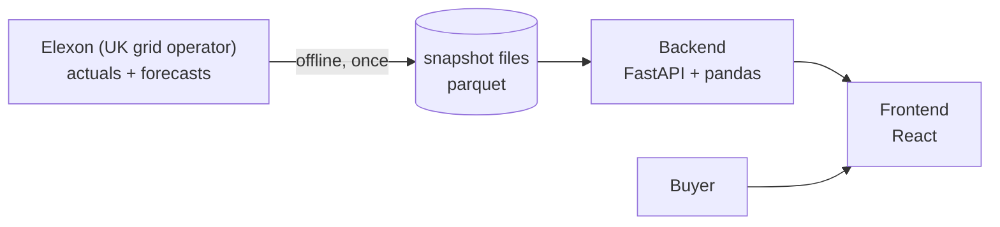
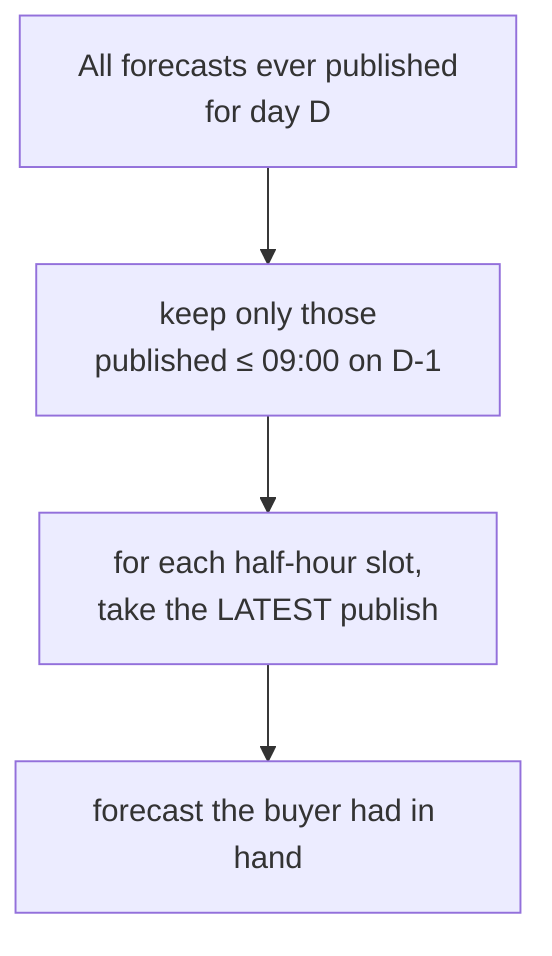
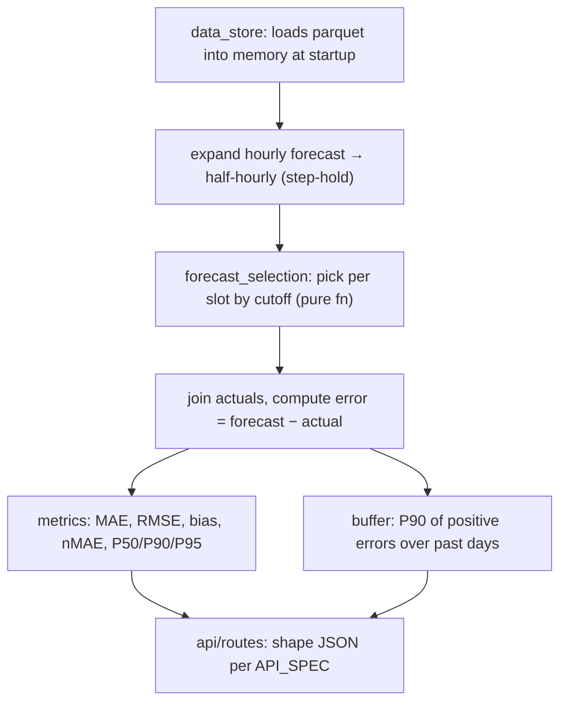
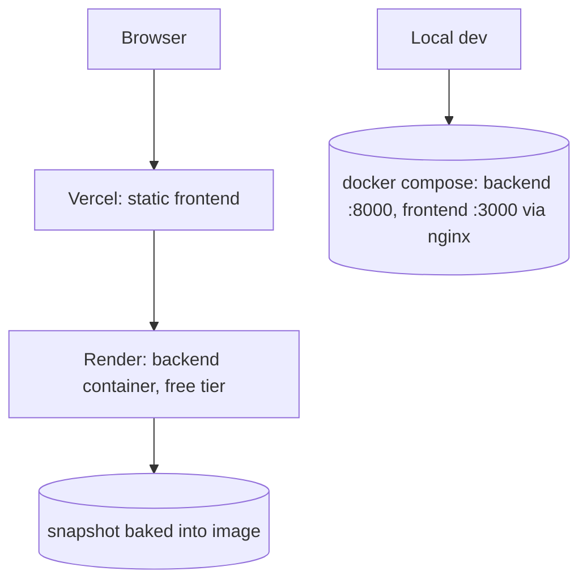

# KT — Wind Forecast Monitor (plain English)

## One-line
A website for a UK utility's day-ahead power buying desk. For any day in January 2026 it shows (1) the wind forecast the buyer actually had in hand at decision time, and (2) how wrong those forecasts were, in megawatts.

## Why it exists
Buyer must commit on D-1 morning for delivery day D. Wind is weather-driven. Need wind forecast available at commit time, plus its error, to decide how much extra power to buy.

## High level

- No database. Data is a committed file (snapshot). Reproducible, no runtime dependency on Elexon.
- Two deployables: frontend (static), backend (one container).

## What "decision-time" means (the core)
Buyer's gate closes 09:00 on D-1. So for delivery day D, only forecasts published at or before that time count. Forecasts published later are ignored even though they exist in the data. This is the whole point: measure what the buyer could have known.

A second, "naive" forecast is computed ignoring the cutoff (uses future info). It is shown only to prove how much better-looking but unusable numbers are.

## Low level — data
- Actuals: `FUELHH`, fuelType=WIND, one row per 30-min slot, 1,536 rows (Jan 2026).
- Forecasts: `WINDFOR`, one row per hour (not half-hour), 20,440 rows, published in cycles of 73 rows covering ~72h ahead.
- Fetch script (`backend/scripts/fetch_data.py`) pulls both via Elexon REST, validates, saves parquet. Run once, commit result.

## Low level — backend

- Pure functions for selection and metrics → unit tested (25 tests). HTTP layer only shapes responses.
- Cutoff is config (`09:00`), change it and everything recomputes.
- Timezones: everything stored/compared in UTC; Europe/London only for cutoff and display.

## Low level — frontend
- 3 pages: Decision view (what did I have?), Accuracy (how wrong?), Methodology (how computed?).
- TanStack Query for server state; date/cutoff in URL params (shareable links).
- Recharts for charts; typed client mirroring backend pydantic models.

## Low level — metrics (plain)
- error = forecast − actual. Positive = over-forecast = buyer short.
- MAE = average absolute error. RMSE = penalises big misses. Bias = average error (direction).
- nMAE = MAE / mean actual (used instead of MAPE because MAPE breaks when generation ≈ 0).
- P90 = "9 times in 10, miss is under this".
- Buffer = P90 of positive (over-forecast) errors only, over an expanding window of past days → "how much to under-buy".

## Deployment

- Backend image: `backend/Dockerfile`, reads `$PORT`, snapshot copied in.
- Frontend: Vite build, `frontend/vercel.json` SPA rewrite.
- Local: `docker compose up --build`.

## Key practices
- Pure core logic + tests on boundaries (cutoff edge cases, naive ≠ decision).
- Config over constants (cutoff, window, CORS).
- Explicit data-quality counts in every response (missing forecast/actual, per-slot flags).
- Typed contract both sides (pydantic ↔ TypeScript), spec in `docs/API_SPEC.md`.
- Lint: ruff (backend), oxlint + tsc (frontend).

## Honest gaps
- `POST /api/refresh` is specified but not implemented.
- `09:00` gate is an assumption, not a verified client rule.
- Wind only, no demand data → no net purchase volume yet.
- Docker compose not actually run in the build env (no daemon) — config-complete but unverified.
- One month of data, one source.