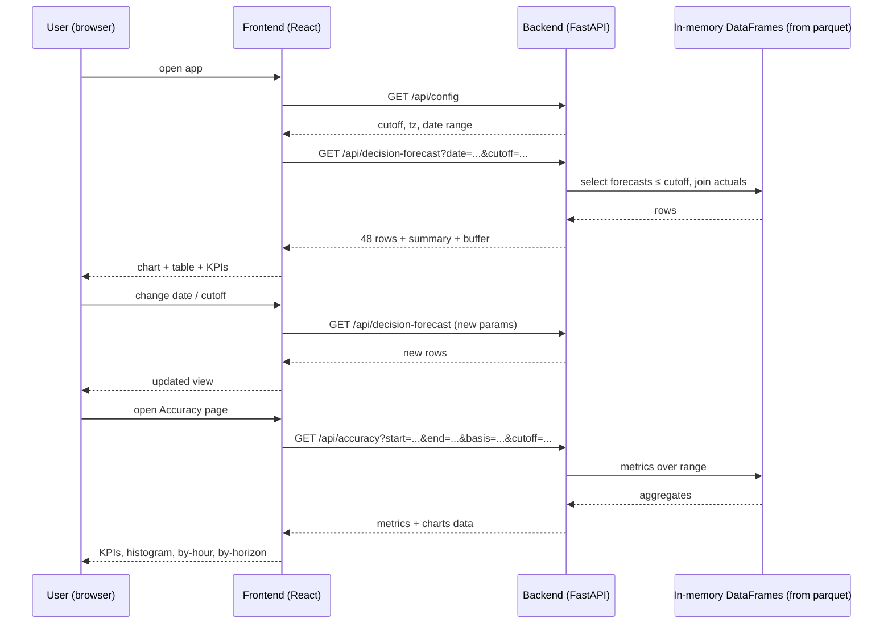

# User Flow (plain English)

## Scenario: buyer checks 15 Jan delivery

### Step 1 — User opens the app
Browser loads the React SPA from Vercel. First call: `GET /api/config` → cutoff time (09:00), timezone (Europe/London), valid delivery range (2 Jan → 1 Feb 2026).

### Step 2 — Decision view (default page)
App auto-fills delivery day = first day in range (2 Jan) and cutoff = 09:00. Calls:
`GET /api/decision-forecast?date=2026-01-02&cutoff=09:00`

Backend:
1. Reads in-memory forecast + actuals DataFrames (loaded at startup from parquet files).
2. Computes cutoff in UTC = 01 Jan 09:00 UTC.
3. For each of the 48 half-hour slots of 2 Jan, picks the forecast with the latest publish time ≤ cutoff.
4. Joins actual generation, computes error = forecast − actual.
5. Computes buffer = P90 of positive (over-forecast) errors from prior days.
6. Returns 48 rows + summary (MAE, RMSE, bias, buffer) + data-quality counts.

Frontend renders: KPI cards, chart (forecast, actual, conservative line), slot table. Amber rows = missing data.

### Step 3 — User changes day/cutoff
User types a new date or cutoff → URL updates → TanStack Query refetches `/api/decision-forecast`. Everything recomputes. No page reload.

### Step 4 — Accuracy page
User clicks "Accuracy" nav. App calls:
`GET /api/accuracy?start=2026-01-02&end=2026-02-01&basis=decision&cutoff=09:00`

Backend:
1. For every delivery day in range, builds decision forecast (same selection rule).
2. Joins actuals, computes errors.
3. Returns overall metrics, by-day, by-hour-of-day, by-horizon, error histogram, plus a "naive" (cutoff-ignored) comparison.

Frontend renders KPIs, time series, histogram, hour-of-day chart, horizon chart, and the "cutoff effect" card (decision MAE vs naive MAE).

### Step 5 — User toggles basis
"Decision-time forecast" ↔ "All horizons" → refetch with `basis=all_horizons`. All-horizons uses every forecast publish, not just the in-hand one (for analysis of lead-time effect).

## Where data comes from
- `backend/data/actuals.parquet` — Elexon FUELHH (WIND), 1,536 rows, 48 slots/day.
- `backend/data/forecasts.parquet` — Elexon WINDFOR, 20,440 rows, hourly publishes.
- Loaded into memory at startup by `data_store.py`. No DB, no runtime Elexon call (except optional `/api/refresh`, not implemented).

## API list (5 endpoints)
| Endpoint | Purpose |
|---|---|
| `GET /api/health` | liveness + row counts |
| `GET /api/config` | cutoff, timezone, valid date range |
| `GET /api/decision-forecast?date=&cutoff=` | 48 slots for one delivery day + summary + buffer |
| `GET /api/accuracy?start=&end=&basis=&cutoff=` | metrics over a range, by hour/horizon/day |
| `POST /api/refresh` | specified, not implemented |

## Flow diagram

